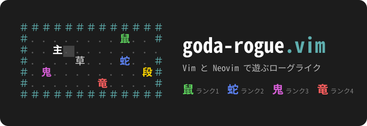

<p align="center">
  
</p>

# goda-rogue.vim

A mystery-dungeon roguelike in Vim and Neovim on
[goda.vim](https://github.com/Shougo/goda.vim). It looks like `rogue`, with no
images: the map is drawn with full-width characters, enemies are kanji, and
their rank is their color.

```
＃＃＃＃＃＃＃＃＃＃＃＃＃
＃．．．．．．．．鼠．．＃　　主  you
＃．．主．．．．．．．．．　　段  the stairs down
＃．．．．草．．．蛇．．＃　　草  an item (a grass)
＃．鬼．．．．．．．．段＃　　鼠 蛇 鬼 竜  enemies: green, blue,
＃．．．．．．竜．．．．＃　　            purple, red by rank
＃＃＃＃＃＃＃＃＃＃＃＃＃
```

> Status: version 0.1.0, the first for others to try. はじまりの洞窟 (30
> floors) is balanced and can be played from start to end; 奈落の洞窟 and
> 果ての洞窟 are not balanced yet (調整中 in the menu). The messages are in
> Japanese only.

What there is: floors made from a seed (big rooms, mazes, monster houses,
shops to buy from, sell to or steal from), 53 families of monsters in four
ranks, weapons and shields with seals, up to two bracelets, grasses,
scrolls, staffs, pots and food to identify, curses and blessings, traps,
hunger, allies, and the wind that ends a run lingering on a floor. A run
can be suspended and resumed, and watched again as a replay; bots play
the dungeons to show how they play, and to compare with your run.

## Requirements

- Vim 9.1 or Neovim 0.11
- Go 1.26 (to build the binary)
- [goda.vim](https://github.com/Shougo/goda.vim) (one with the `dir`
  option of `goda#configured#new()`)

## Usage

There are no default mappings: map the actions in the game buffer (its
filetype is `goda-rogue`):

```vim
autocmd FileType goda-rogue call s:goda_rogue_settings()
function s:goda_rogue_settings() abort
  const dirs = #{h: 'left', j: 'down', k: 'up', l: 'right',
        \ y: 'upleft', u: 'upright', b: 'downleft', n: 'downright'}
  for [key, dir] in items(dirs)
    execute $'nnoremap <buffer> {key} <Cmd>call goda_rogue#do("move", "{dir}")<CR>'
    execute $'nnoremap <buffer> g{key} <Cmd>call goda_rogue#do("turn", "{dir}")<CR>'
    execute $'nnoremap <buffer> {key->toupper()} <Cmd>call goda_rogue#do("dash", "{dir}")<CR>'
  endfor
  nnoremap <buffer> <Space> <Cmd>call goda_rogue#do('attack')<CR>
  " Face an enemy next to the player (again: the next one).
  nnoremap <buffer> t <Cmd>call goda_rogue#do('turn')<CR>
  nnoremap <buffer> . <Cmd>call goda_rogue#do('wait')<CR>
  nnoremap <buffer> > <Cmd>call goda_rogue#do('stairs')<CR>
  nnoremap <buffer> i <Cmd>call goda_rogue#do('inventory')<CR>
  " What is under the player: the item, else a found trap.
  nnoremap <buffer> ; <Cmd>call goda_rogue#do('foot')<CR>
  nnoremap <buffer> , <Cmd>call goda_rogue#do('pickup')<CR>
  nnoremap <buffer> f <Cmd>call goda_rogue#do('shoot')<CR>
  nnoremap <buffer> x <Cmd>call goda_rogue#do('look')<CR>
  nnoremap <buffer> c <Cmd>call goda_rogue#do('catalog')<CR>
  nnoremap <buffer> m <Cmd>call goda_rogue#do('map')<CR>
  nnoremap <buffer> I <Cmd>call goda_rogue#do('items')<CR>
  nnoremap <buffer> M <Cmd>call goda_rogue#do('log')<CR>
  nnoremap <buffer> S <Cmd>call goda_rogue#suspend()<CR>
  " Watching a replay or a bot: pause, step, ten steps, to the end.
  nnoremap <buffer> p <Cmd>call goda_rogue#replay_pause()<CR>
  nnoremap <buffer> ] <Cmd>call goda_rogue#replay_step()<CR>
  nnoremap <buffer> } <Cmd>call goda_rogue#replay_step(10)<CR>
  nnoremap <buffer> G <Cmd>call goda_rogue#replay_step(-1)<CR>
endfunction
```

Then:

```vim
" Choose a dungeon, and start (or resume a suspended run).
call goda_rogue#start()
" The same seed makes the same floors.
call goda_rogue#start(#{dungeon: 'cave', seed: 'vim'})
" Keep the replay of the last run, and watch it.
call goda_rogue#replay(goda_rogue#save_replay())
" Watch a bot play (also from the menu of a dungeon).
call goda_rogue#watch_bot(#{dungeon: 'cave'})
" Where would a bot have played the last run another way?
call goda_rogue#compare_bot()
" The records of the finished runs, the best first.
call goda_rogue#records()
```

The binary is built on the first start (it takes a while), into a cache
directory. `:help goda-rogue-playing` tells how to play a first run, and
`:help goda-rogue` everything else.

## Dungeons

Dungeons are data: tab-separated text files in `rogue/dungeons/{id}/`
(monsters, which floors they appear on, items, rules, growth tables).
There are three: `cave` (はじまりの洞窟, 30 floors), `deep` (奈落の洞窟, 50
floors, with the monsters of the higher ranks) and `far` (果ての洞窟, 99
floors); `deep` and `far` are not balanced yet. A dungeon can be based on
another and have only the files that differ.
See `:help goda-rogue-dungeons`.

To see how a dungeon plays, let bots play it many times:

```sh
go run ./cmd/analyze -dungeon cave -runs 200
```

## Reporting a bug

Please open an issue with:

- What happened, and what you expected.
- The replay of the run: `:call goda_rogue#save_replay()` saves the
  replay of the last run and returns its path (`:echo` it). Attach the
  file: it replays the run exactly, with the seed and the version in it.
- `:version` of Vim or Neovim, the OS, and the revision of goda.vim and of
  goda-rogue.vim (`git rev-parse --short HEAD` in each).

Impressions are welcome too, as an issue or on social media.

## License

MIT, see [LICENSE](LICENSE).
